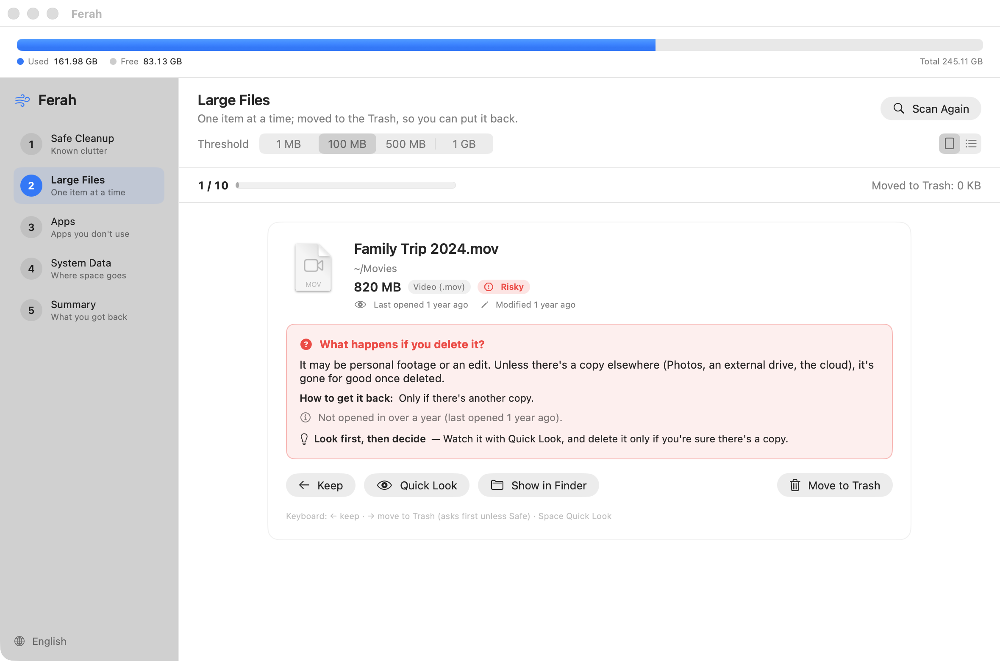
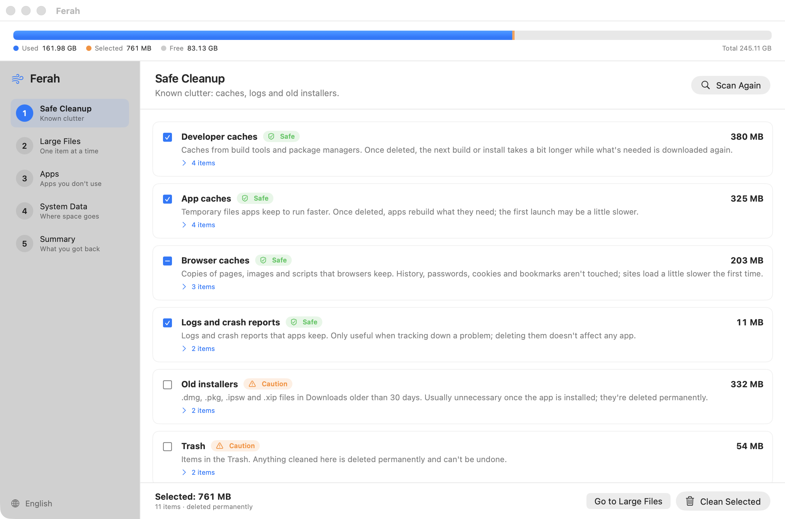
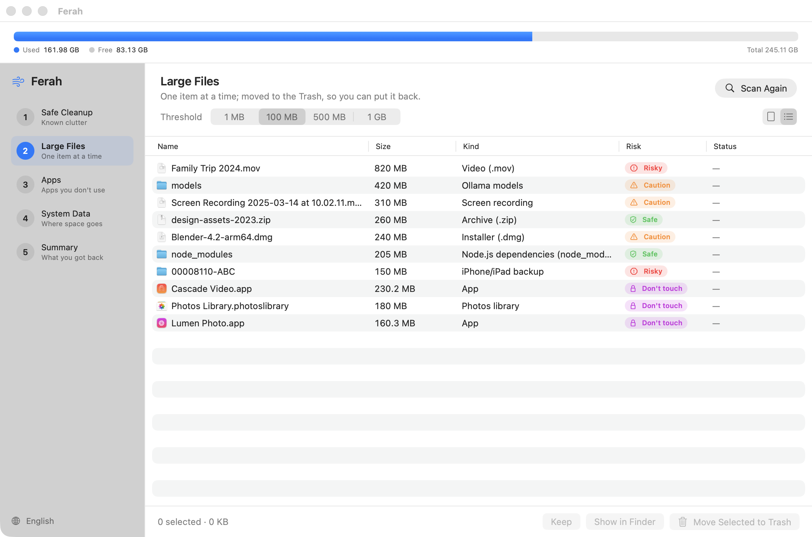
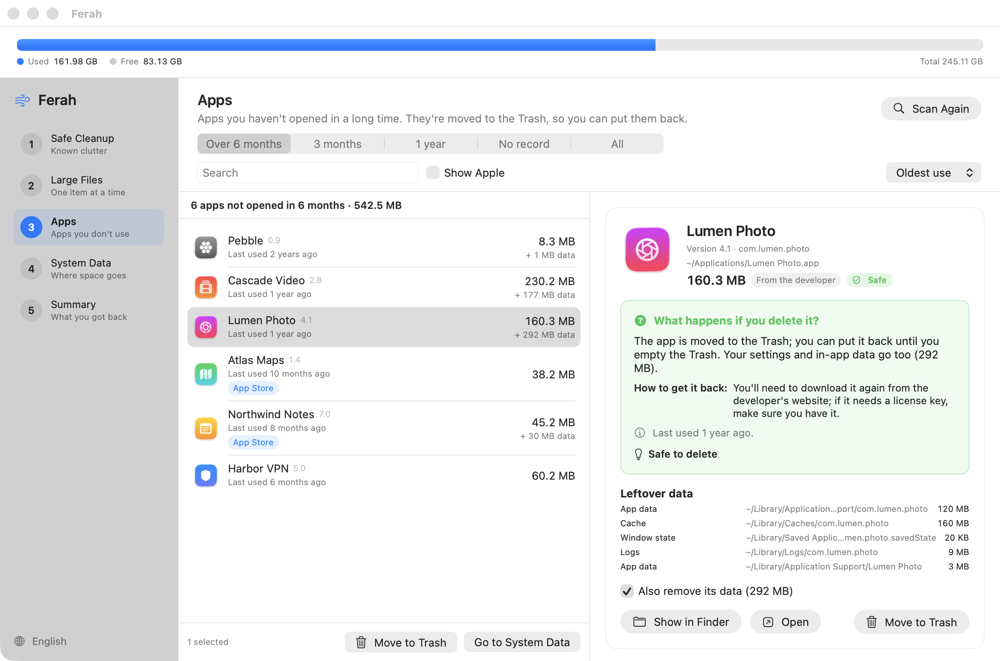
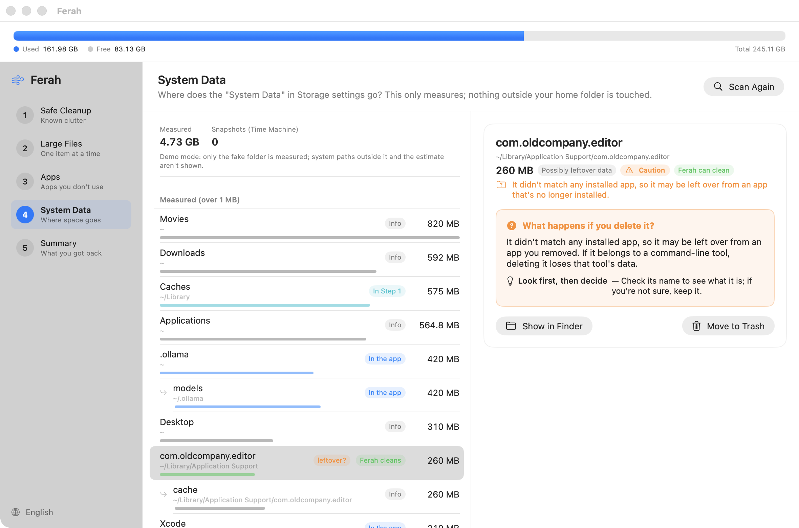
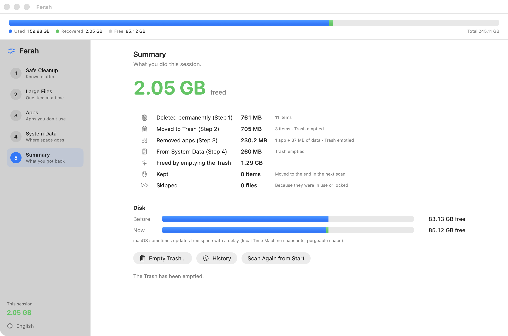

# Ferah

A native, offline disk cleaner for macOS. What sets it apart: it never deletes without asking, and for every item it answers **"What happens if you delete it?"**

**English** · [Türkçe](README.tr.md)

<p align="center"></p>

> [!WARNING]
> Ferah deletes files. It comes with no warranty (see [LICENSE](LICENSE)). Don't use it without a backup of your important data. Read the [Status](#status) section below.

## What it does

It works in five steps:

1. **Safe Cleanup.** Scans known clutter: app and browser caches, logs, developer caches (Xcode DerivedData, npm, pip, Homebrew…), the Trash, and old installers in Downloads. Each category says what it is and what happens if you delete it. Safe items come preselected; "Caution" items don't. Items in this step are **deleted permanently** after you confirm.
2. **Large Files.** Goes through large files and regenerable folders in your home folder (`node_modules`, `.venv`, `Pods`, build output) one card at a time. Items in this step are **moved to the Trash**, so you can put them back.
3. **Apps.** Lists apps you haven't opened in a long time, with last-used date, size and the data they leave behind. They're **moved to the Trash**.
4. **System Data.** Measures where the "System Data" shown in Storage settings goes, and tells you what you can do about each item.
5. **Summary.** Space recovered, what was done, and a history of every action.

The interface is available in Turkish and English. It follows the system language (Turkish if your system is set to Turkish, otherwise English), and you can switch it from the globe menu at the bottom of the sidebar.

## Screenshots

<table>
<tr>
<td width="50%"><br><b>Safe Cleanup</b> — known clutter, grouped and explained</td>
<td width="50%"><br><b>Large Files</b> — list view, with a risk for every item</td>
</tr>
<tr>
<td><br><b>Apps</b> — what you haven't opened in months, and what it leaves behind</td>
<td><br><b>System Data</b> — where the space goes, and what you can do about it</td>
</tr>
<tr>
<td colspan="2" align="center"><br><b>Summary</b> — what was freed, step by step</td>
</tr>
</table>

Screenshots were taken in demo mode, on a fake home folder with made-up apps and files.

### "What happens if you delete it?"

Explanations come from a rule-based, offline engine; no data ever leaves your Mac. A few examples:

| Item | What Ferah says |
|---|---|
| `node_modules` | Comes back with `npm install`; the project isn't damaged, the first run takes longer |
| Personal video | Gone for good unless there's a copy elsewhere |
| `Docker.raw` | All images, containers and volumes go with it |
| Encrypted `.dmg` | Most likely a vault; better to keep |
| File in iCloud Drive | Also removed from all your devices and the cloud |
| App Store app | Can be downloaded again for free from Purchased |

When no rule matches, it says so plainly and suggests keeping the item.

## Safety

Every delete and move goes through a single checkpoint ([Bekci.swift](Sources/FerahCore/Bekci.swift)). It refuses:

- paths outside your home folder;
- the standard folders themselves (Desktop, Documents, Downloads…);
- protected data: the Photos library, keychains, Mail, Messages, `.ssh`…;
- escape attempts through symbolic links or `..`;
- in Step 1, any path outside that category's allowed folders.

Only app removal can go outside your home folder, and only for real `.app` bundles in `/Applications` and `~/Applications`. Apple apps, apps that are running and Ferah itself are refused.

These rules are tested in a temporary folder with `--oz-sinama` (273 tests). The app's view model is also driven end to end on a fake home with `--akis-sinama` (82 tests). Both suites were run and passed separately in Turkish and English (`--dil tr`, `--dil en`).

## Installation

### Download

1. Download `Ferah-1.0.zip` from the [latest release](https://github.com/efefdev/Ferah/releases/latest). It's a universal app (Apple silicon and Intel) for macOS 14 or later.
2. Open the zip and move `Ferah.app` to your Applications folder.
3. Ferah isn't signed with an Apple Developer ID yet, so the first time you open it macOS says it can't verify the developer. Click **Done** (not "Move to Trash"), then go to **System Settings > Privacy & Security**, scroll down and click **Open Anyway** next to the message about Ferah. You only need to do this once.

   If you prefer the Terminal, this does the same:

   ```bash
   xattr -dr com.apple.quarantine /Applications/Ferah.app
   ```

You can check the download against the SHA-256 listed in the release notes:

```bash
shasum -a 256 ~/Downloads/Ferah-1.0.zip
```

### Build from source

You don't need Xcode; the Command Line Tools are enough.

**Requirements:** macOS 14 or later, Swift 6 (`xcode-select --install`).

```bash
git clone https://github.com/efefdev/Ferah.git
```

```bash
cd Ferah && ./paketle.sh
```

```bash
open build/Ferah.app
```

`paketle.sh` builds `build/Ferah.app` for your Mac's architecture and signs it ad hoc; `./paketle.sh --evrensel` builds a universal (Apple silicon + Intel) app, as used for releases. You can move it to your Applications folder if you like.

### Full Disk Access

Without permission, macOS doesn't let apps read some folders: the Trash, Safari's cache, iOS backups and other apps' containers. Ferah doesn't crash on these; it says "No access permission" and doesn't measure other apps' containers at all.

To see everything, add Ferah in **System Settings > Privacy & Security > Full Disk Access**. The "Grant Full Disk Access…" button in the app opens that pane. Because the app is signed ad hoc, you may need to grant access again after each rebuild.

## Status

What is and isn't tested:

- **Tested automatically:** the safety rules, the deletion layer and the explanation engine (`--oz-sinama`). The app's view model is also driven on a fake home through the same methods the buttons call (`--akis-sinama`). That covers:
  - the Step 1 cleanup;
  - emptying the Trash;
  - removing apps (with "Also remove its data" on and off);
  - moving a System Data item;
  - cancelling a scan and double clicks;
  - a file disappearing or turning into a symbolic link between the scan and the deletion.
- **Tried by hand:** every page was also driven end to end in demo mode by pressing the real buttons through macOS Accessibility (not by calling methods): Step 1 cleanup with its confirmation, Large Files keep / move / keyboard confirmation / list-view bulk move, removing apps with "Also remove its data" off and on, moving a System Data item, emptying the Trash, History, and switching the language live. Files on disk were checked after each step.
- **Visual check:** checked by eye in demo mode, in light and dark appearance, in Turkish and English: five pages, a confirmation dialog, and the smallest window size. Quick Look wasn't checked visually.
- **One Mac:** run on a single Mac only (Apple silicon, macOS 26). The Intel half of the universal app passes the self-tests and flow tests under Rosetta, but hasn't been run on a real Intel Mac.
- **APFS clones:** the size shown is the space actually freed on deletion (`ATTR_CMNEXT_PRIVATESIZE`). A clone on its own shows ~0; if every member of a clone family is in the same measurement, the shared part is counted once. Limits:
  - The shared part of partially modified clones is never counted as freed (conservative).
  - For speed, clone information is only read for files larger than 1 MB.
- **Without Full Disk Access:** other apps' containers (such as WhatsApp) aren't measured, to avoid permission prompts. The "estimated unmeasured" figure on the System Data page is a rough difference.
- **Last-used date:** comes from Spotlight. Dates before 2001 (some installers write 1980) count as "no record"; if Spotlight holds a wrong date, the suggestion can be wrong too.
- **Put Back:** it hasn't been verified that Finder's "Put Back" works for items moved to the Trash.
- **Language:** Turkish and English. When you switch language inside the app, Ferah's own text changes immediately; macOS menus and system dialogs change after a restart. Error messages that come from macOS itself (for example some move errors) stay in the system language.

If you find a bug or an explanation is wrong, please open an issue; an item wrongly labelled "Safe" is the most important kind of bug.

## Development

```
Sources/FerahCore/            scanning, rules, explanation engine, safety checks, deletion (UI-independent)
Sources/Ferah/                SwiftUI interface and command-line modes
araclar/metinler.tsv          every interface and explanation string (key, Turkish, English)
araclar/metinleri-uret.py     generates Sources/FerahCore/Metinler.swift from metinler.tsv
araclar/simge.swift           draws the app icon
paketle.sh                    builds, assembles the .app bundle and signs it
```

Command-line modes don't open the interface and (except the self-test) are read-only:

```bash
.build/release/Ferah --oz-sinama
```

```bash
.build/release/Ferah --tara-json
```

```bash
.build/release/Ferah --buyuk-json --esik 500
```

```bash
.build/release/Ferah --uygulamalar-json
```

```bash
.build/release/Ferah --sistem-json
```

- `--oz-sinama`: builds a fake file tree in a temporary folder and tests the safety, deletion and explanation rules. It never touches your real files.
- The others print the corresponding step's scan as JSON. The output is a listing of your own disk; review it before sharing.
- To open the app with a scan running: `--ac-ve-tara`, `--ac-buyuk`, `--ac-uygulamalar`, `--ac-sistem`. To force the appearance: `--tema acik|koyu`.
- `--dil tr|en` forces the language in every mode (the interface, human-readable values in the JSON, and the language the tests render). JSON field names don't depend on the language.

### Language and strings

Every user-facing string is one line in `araclar/metinler.tsv`: `key<TAB>Turkish<TAB>English`. The code only uses keys; the explanation engines produce language-independent `Metin` values that are rendered in the selected language when shown.

- Placeholders `{0}`, `{1}`… must match in every language. English plurals use the form `singular||plural`.
- After editing, run `python3 araclar/metinleri-uret.py` to regenerate `Metinler.swift`.
- A string missing in any language breaks the build. `--oz-sinama` also checks the placeholders and that no Turkish letters or words are left in the English output.
- Language choice: `--dil` > in-app choice (the globe at the bottom of the sidebar) > system language (Turkish if it's Turkish, otherwise English).

To add a new language:

1. Add a column to `metinler.tsv`.
2. Make `metinleri-uret.py` add that column to the `cift` output.
3. Add a case and a `yerel` value to the `Dil` type, and extend the selection in `Ceviri.sablon`.
4. Update the `Dil.sistemden` rule.
5. Add the language to `CFBundleLocalizations` in `paketle.sh`, with a `.lproj` folder.
6. Run `--oz-sinama --dil <new>`.

### Demo mode

Runs the whole app on a fake home in the temporary directory, without touching your real files:

```bash
.build/release/Ferah --deneme-evi-kur "$TMPDIR/ferah-deneme"
```

```bash
.build/release/Ferah --deneme-evi "$TMPDIR/ferah-deneme"
```

- The first command builds a realistic tree inside the fake home: caches, a locked file, a full Trash, an old `.dmg`, large files, an APFS clone, a project with `node_modules`, fake apps and their leftovers, imitations of protected items, and symbolic-link traps that point outside.
- In demo mode, the home folder, the application folder (`<folder>/Applications`), the Trash (`<folder>/.Trash`) and the history all live inside the fake home. System paths outside the home aren't scanned. The large-file threshold goes down to 1 MB.
- A yellow "DEMO MODE" bar stays at the top of the window.
- Ferah refuses to start if the folder isn't inside the temporary directory (`$TMPDIR`), or if it is or contains your real home folder, `/`, `/Applications` or `/Users`.

```bash
.build/release/Ferah --akis-sinama
```

`--akis-sinama` builds its own demo home, drives the view model the app uses through all five steps, checks the file system after each step, and deletes the demo home at the end.

After any change that touches deletion code, run `--oz-sinama`; if you add a new deletion path, add a test for it too.

## Data

Ferah only writes to this folder: `~/Library/Application Support/Ferah/` (in demo mode, to its counterpart inside the fake home).

- `gecmis.json`: every action (date, path, size, method)
- `saklananlar.json`: files you chose to keep (moved to the end in the next scan)

The in-app language choice is stored in the app's macOS preferences (the `FerahDil` key); it isn't saved in demo mode or when `--dil` is used. macOS itself remembers the window size.

It makes no network connections and sends no data.

## License

[MIT](LICENSE)
